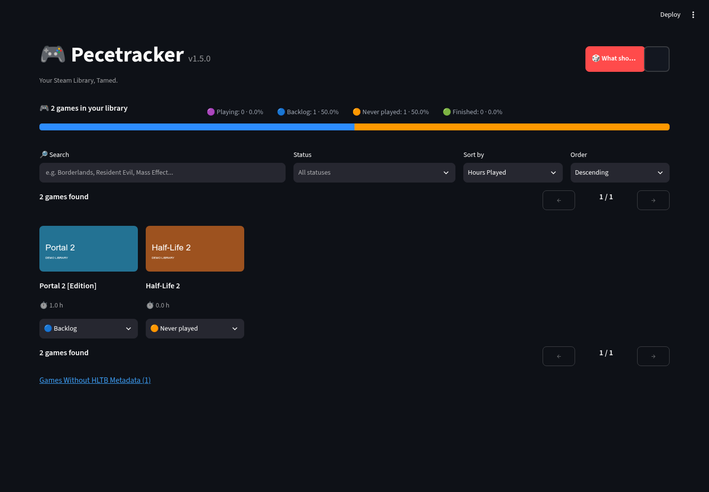
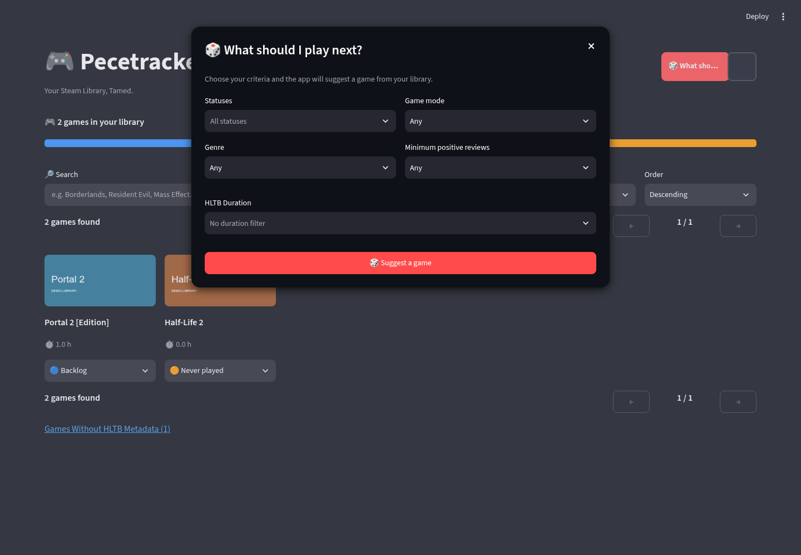
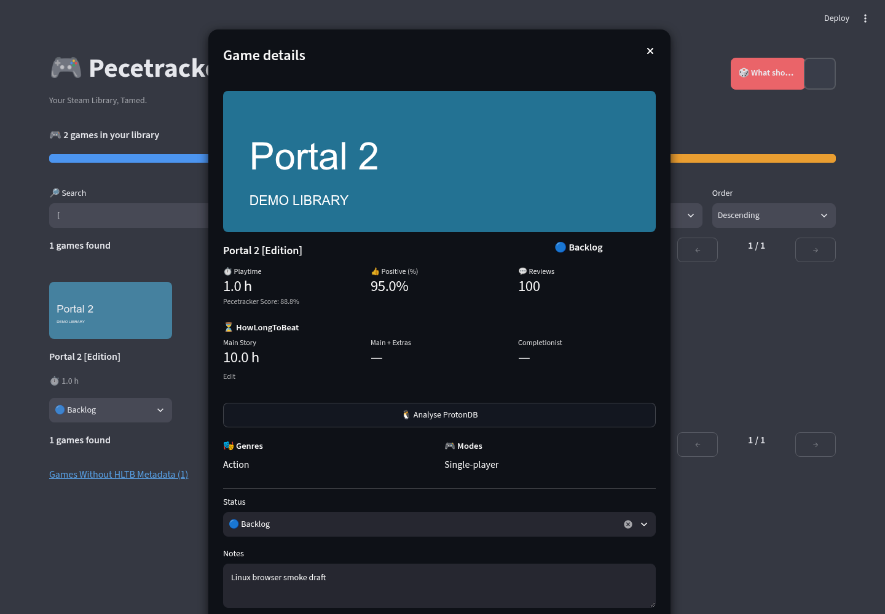

# Pecetracker

**Your Steam Library, Tamed.**

A Steam library and backlog manager.

[Repository](https://github.com/Atecep/pecetracker) · [Releases](https://github.com/Atecep/pecetracker/releases)

Pecetracker runs locally on your computer and uses the Steam Web API to load your games and playtime. Personal statuses, notes and cached metadata are stored locally.



Screenshots show a demo library with illustrative covers; no personal data is used.

## Features

- Import your Steam library and playtime
- Organise games by status:
  - Never played
  - Backlog
  - Playing
  - Finished
- Add personal notes to games
- Browse, search, filter and sort your library
- View cached Steam Store metadata, including genres, categories, developers, publishers and reviews
- View **HowLongToBeat** estimates for:
  - Main Story
  - Main + Extras
  - Completionist
- Manually assign a HowLongToBeat ID when an automatic match is unavailable
- Sort your library by HowLongToBeat duration
- Analyse **ProtonDB** ratings and community launch options on demand (Linux only)
- Use **Smart Pick** when you do not know what to play
  - Filter by status
  - Filter by genre and game mode
  - Filter by Steam review score
  - Filter by HowLongToBeat duration
- Use **Pecetracker Review Score**, based on Steam review data, for more useful review-based sorting
- Refresh Steam and HowLongToBeat metadata in the background
- Quickly inspect games without Steam or HowLongToBeat metadata
- Export and restore your local library backup
- Local persistent storage
- Single-instance launcher with automatic recovery
- Update notifications through GitHub Releases
- Standalone builds for Windows and Linux

## Download

Pre-built versions are distributed through [GitHub Releases](https://github.com/Atecep/pecetracker/releases).
The names below describe new Pecetracker builds. Historical releases retain their
original SteamLibraryTracker archive/executable names. The rebranding keeps
version 1.5.0 during validation; a 1.6.0 release has not been prepared or published.

### Windows

1. Download the Windows `.zip` release.
2. Extract the archive.
3. Run:

```text
Pecetracker.exe
```

No Python installation is required.

### Linux

1. Download the Linux `.tar.xz` release.
2. Extract it:

```bash
tar -xf Pecetracker-v1.5.0-linux-x86_64.tar.xz
cd Pecetracker
```

3. Enter the extracted directory and run:

```bash
./Pecetracker
```

If execution permission is missing:

```bash
chmod +x Pecetracker
./Pecetracker
```

No Python installation is required.

## First launch

On first launch, Pecetracker asks for the information required to access your Steam library.

You will need:

- a Steam Web API key
- your SteamID64

After your library is loaded, Pecetracker uses its global metadata catalogue to populate available Steam Store and HowLongToBeat metadata for your games. Any missing or outdated metadata can then continue to update in the background.

## Smart Pick

**Smart Pick** helps choose a game from your library while respecting the filters you select.

Filters can include status, genre, game mode, Steam review score and HowLongToBeat duration. Games without metadata remain eligible when the selected filters do not require that metadata.

You can reroll a suggestion while keeping the same filters.



## HowLongToBeat

Pecetracker can match games in your Steam library with HowLongToBeat and cache available completion-time estimates locally.

Automatic matching is intentionally conservative to reduce incorrect matches. If no reliable match is found, you can enter the game's HowLongToBeat ID manually from the game details window.

HowLongToBeat data is used for display, library sorting and optional Smart Pick duration filters.



## ProtonDB

ProtonDB analysis is available exclusively on Linux and runs entirely on demand. Click **Analyse ProtonDB** in the game details window to open a separate dialog with the ProtonDB rating and community launch options.

Launch options from successful community reports are ranked by frequency, with more weight given to recent reports. Where possible, the analysis considers AMD and NVIDIA hardware differences to filter out options intended for a different GPU.

Commands are displayed for reference only. Pecetracker never applies or executes them automatically.

Click **← Back** to return to the game's details.

## Local data

Pecetracker stores user data outside the application folder so updates do not overwrite your settings, statuses or notes.

Pecetracker is the new name of Steam Library Tracker. The historical data folder
name is intentionally retained on both platforms, for existing and new users.
No data is moved, copied, renamed or reset during this change. Keep using the
same folder for SQLite, settings, logs and instance state.

### Linux

```text
~/.local/share/SteamLibraryTracker/
```

### Windows

```text
%LOCALAPPDATA%\SteamLibraryTracker\
```

This folder contains files such as:

```text
config.json
library.db
```

Your local database contains personal game statuses and notes together with cached Steam and HowLongToBeat metadata.

## Backup and restore

The in-app JSON backup exports the personal statuses and notes you saved. Restore merges those entries into the local database.

It is not a complete database backup: settings, API keys, cached metadata and manually assigned HowLongToBeat IDs are excluded. To retain manual HLTB assignments when moving computers, close Pecetracker normally and copy the application data directory, keeping any SQLite sidecar files together with `library.db`. Treat `config.json` and its backup as private because they contain your API key.

This is useful when moving to another computer or before making changes to your local installation.

Diagnostics are written to `slt.log` in the same application data directory, with size-limited rotation. Windows builds retain their normal windowed behavior. Existing configurations are replaced atomically; the previous file is retained as `config.json.bak`.

## Updates

Pecetracker can check GitHub Releases for newer versions.

Updates and the global metadata bootstrap use `Atecep/pecetracker`. Older builds
still use the former GitHub URL and depend on GitHub's repository-rename redirects;
do not recreate a repository at the old address. The `global-db` release, existing
tags and `global_metadata.db*` assets retain their names.

When a newer version is available, the app displays an update notification with a link to the corresponding release.

## Privacy

Pecetracker is a local desktop application.

Personal notes, statuses, configuration and cached library data remain on your computer unless you explicitly export or share them.

Network requests are used only to retrieve the Steam library, application metadata, HowLongToBeat data, ProtonDB reports and update information required by the app.

## Development

For instructions on running or building Pecetracker from source, see [BUILDING.md](BUILDING.md).

## Disclaimer

Pecetracker is an independent project and is not affiliated with or endorsed by Valve Corporation or HowLongToBeat.

Steam and the Steam logo are trademarks and/or registered trademarks of Valve Corporation.
